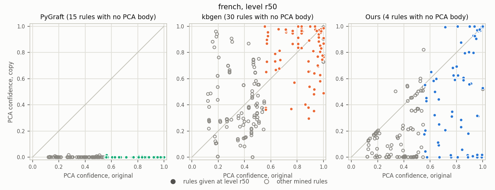

# Rule confidence on the synthetic copies

Of the three generators, this one keeps the PCA confidence of the mined rules closest to the original graph. On the rules it was given, their order by confidence survives: median Spearman's rho 0.61 to 0.85 at levels r25 to r100, against 0.24 to 0.42 for kbgen and about 0.2 for PyGraft. Its weak point is the level: it lowers the rules' PCA confidence by a median 0.13 to 0.16, where kbgen raises it by 0.12 to 0.27 and leaves 593 of 4,992 rules with an empty PCA body.

The copies compared are the rule-level copies of [`rule-levels.md`](rule-levels.md) and PyGraft's copies, as of 17 November 2026.

## Measure

`scripts/rule_confidence.py` counts every mined rule's support, body size and PCA body size on each original graph and on each copy, reading only the `.tsv` files. Std confidence is support / body size and PCA confidence is support / PCA body size, as AMIE and the summary of `cli/main.py` compute them. The PCA body size counts the body groundings whose functional variable (the `functional_variable` column of the rules CSV) has some fact of the head relation.

- Copies: this generator's and kbgen's at each rule level that has a copy of its own (`<dataset>_ours_<level>`, `<dataset>_kbgen_<level>`), and PyGraft's single copy (`<dataset>_pygraft`), made without rules, at every level. PyGraft has no YAGO3-10 copy.
- Rules given at a level: the rules this generator used there (`<dataset>_ours_<level>_used.csv`), which kbgen was given too. Each rule is also marked as `removed` (kept by the level's threshold, dropped by cycle removal) or `not_given`, and a given rule as complete (std confidence 1) or partial.
- Empty PCA body: a rule with no body grounding whose functional variable has a head fact has no PCA confidence on that copy. It is counted apart and left out of every other measure.
- Checks: on each original graph, the counts of all 2,057 rules equal AMIE's `positive_examples`, `body_size` and `pca_body_size` (on the triples as AMIE read them, see `rule_set_table.as_amie_reads`). With `--check-logs`, all 20,676 confidences of this generator's copies equal the summaries of the runs that made them (`runs/rule-levels/ours/<copy>.log`) to 3 decimals.

The 219 graphs take 2 min 21 s with 6 workers:

```bash
python scripts/rule_confidence.py --workers 6 --check-logs
```

It writes `exp_analysis/rule_confidence/`: `rules.csv` (one row per dataset, level, generator and rule, with the counts and confidences on the original and on the copy), `summary.csv` (per dataset, level, generator and group of rules: given, given complete, given partial, not given, all), `summary_<level>.md`/`.tex`/`.csv` (the given rules, one row per dataset, one column per generator) and `plots/<dataset>_<level>.png` (each rule's PCA confidence on the original against the copy, one panel per generator).

## Summary by level

PCA confidence of the rules given at each level, median over the datasets with copies at that level. PyGraft is measured on fewer datasets and rules, since it has no YAGO3-10 copy.

| Level | Generator | Datasets | Rules given | Share within 0.05 | Median abs. difference | Spearman's rho | Mean difference | Rules with empty PCA body |
|---|---|---|---|---|---|---|---|---|
| std1 | PyGraft | 4 | 25 | 0.000 | 1.000 | - | -1.000 | 0 |
| std1 | kbgen | 4 | 25 | 0.500 | 0.085 | - | -0.087 | 0 |
| std1 | Ours | 4 | 25 | 1.000 | 0.000 | - | 0.000 | 0 |
| r25 | PyGraft | 15 | 338 | 0.000 | 0.771 | 0.184 | -0.784 | 35 |
| r25 | kbgen | 20 | 475 | 0.072 | 0.149 | 0.236 | 0.123 | 102 |
| r25 | Ours | 20 | 475 | 0.162 | 0.189 | 0.611 | -0.131 | 0 |
| r50 | PyGraft | 15 | 703 | 0.000 | 0.640 | 0.234 | -0.642 | 51 |
| r50 | kbgen | 20 | 982 | 0.092 | 0.212 | 0.395 | 0.199 | 126 |
| r50 | Ours | 20 | 982 | 0.144 | 0.178 | 0.714 | -0.154 | 0 |
| r75 | PyGraft | 15 | 1,083 | 0.000 | 0.500 | 0.218 | -0.496 | 58 |
| r75 | kbgen | 20 | 1,504 | 0.090 | 0.262 | 0.412 | 0.269 | 176 |
| r75 | Ours | 20 | 1,504 | 0.084 | 0.162 | 0.814 | -0.158 | 0 |
| r100 | PyGraft | 19 | 1,445 | 0.000 | 0.468 | 0.199 | -0.531 | 58 |
| r100 | kbgen | 24 | 2,006 | 0.071 | 0.265 | 0.421 | 0.221 | 189 |
| r100 | Ours | 24 | 2,006 | 0.116 | 0.137 | 0.854 | -0.131 | 0 |

This generator has the smallest median difference at std1 and r50 to r100, and the most rules within 0.05 at every level but r75. Spearman's rho is undefined at std1, where every rule has PCA confidence 1. The mean difference is copy minus original.

## Findings by generator

The counts below pool every level, so a rule given at several levels counts once per level.

- Complete rules (std confidence 1): this generator keeps all 133 at exactly their original PCA confidence, since completion forward-chains them. kbgen keeps 23 of 133, with a median change of -0.17. PyGraft drops all of them to 0.
- Partial rules: this generator lowers them (median -0.19, 12% within 0.05) and kbgen raises them (median +0.21, 11% within 0.05). The random facts of this generator add body groundings without a head, which lowers the confidence (item 11 of section 8 in [`algorithm.md`](algorithm.md)).
- Empty PCA bodies: kbgen leaves 593 of the 4,992 rules given over all levels with one; this generator leaves none. kbgen's copies are also smaller: 6,572 triples for french against 10,332.
- Rules not given at a level: every generator lowers them, this one by a median 0.23, kbgen by 0.18 and PyGraft by 0.35. No generator preserves rules it was not given.
- PyGraft keeps the relation names but no rule: the rules' PCA confidence on its copies is close to 0 at every level.
- `family` is the exception for this generator. Completion derives about three times the source's triples (91,369 against 28,358 at r25, see `runs/rule-levels/REPORT.md`), so its partial rules lose 0.50 (r100) to 0.83 (r25) of PCA confidence, and its median absolute difference is 0.45 to 0.81 at r25 to r100, against 0.18 to 0.45 for kbgen.

Per dataset, this generator has a smaller median difference than kbgen in 59 of the 88 dataset-level rows, and a higher Spearman's rho in 67 of the 80 rows where both have one. It wins at every level of Family1_N, FamilyN_1, FamilyM_N, WN18RR1_1, WN18RRN_1, YAGO3-10_1_1 and YAGO3-10_1_N; kbgen does better on french1_1, frenchN_1, family and WN18RR1_N. `summary_<level>.md` gives the values of every dataset.

## french at r50



Of the 111 rules given, this generator keeps 39 within 0.05 of their original PCA confidence, kbgen 20 (17 more have an empty PCA body) and PyGraft none. On this generator's copy, 20 of the 111 rules fall below 0.06. They are partial rules with `spouse`, `parent`, `father`, `mother` or `child` at the head, such as `?e father ?b  ?e mother ?a => ?a spouse ?b` (rule 31). Their support drops from 34 to 1,007 on the original to 0 to 40, while their bodies keep 59 to 1,277 groundings. The run log (`runs/rule-levels/ours/french_ours_r50.log`) warns that the EDB found no candidate values for many partial-rule groundings and skipped them.

## French datasets

Given rules within 0.05 of their original PCA confidence, out of those with a PCA confidence on the copy, with the median absolute difference in parentheses and `+n` the rules with an empty PCA body:

| Dataset | Level | PyGraft | kbgen | Ours |
|---|---|---|---|---|
| french | r25 | 0 of 43 (0.975) +8 | 13 of 39 (0.141) +12 | 29 of 51 (0.015) |
| french | r50 | 0 of 101 (0.852) +10 | 20 of 94 (0.153) +17 | 39 of 111 (0.153) |
| french | r75 | 0 of 160 (0.665) +11 | 20 of 145 (0.160) +26 | 51 of 171 (0.247) |
| french | r100 | 0 of 220 (0.529) +11 | 34 of 204 (0.180) +27 | 64 of 231 (0.218) |
| french1_1 | r25 | 0 of 39 (0.938) +11 | 18 of 30 (0.034) +20 | 22 of 50 (0.075) |
| french1_1 | r50 | 0 of 87 (0.799) +19 | 17 of 83 (0.156) +23 | 32 of 106 (0.250) |
| french1_1 | r75 | 0 of 137 (0.581) +25 | 18 of 135 (0.165) +27 | 33 of 162 (0.274) |
| french1_1 | r100 | 0 of 192 (0.468) +25 | 35 of 190 (0.189) +27 | 43 of 217 (0.239) |
| french1_N | r25 | 0 of 4 (0.587) | 0 of 4 (0.204) | 0 of 4 (0.222) |
| french1_N | r50 | 0 of 8 (0.461) | 0 of 8 (0.296) | 0 of 8 (0.214) |
| french1_N | r75 | 0 of 12 (0.313) | 0 of 12 (0.431) | 1 of 12 (0.198) |
| french1_N | r100 | 0 of 15 (0.287) | 0 of 15 (0.481) | 1 of 15 (0.197) |
| frenchN_1 | r25 | 0 of 23 (0.767) +8 | 6 of 15 (0.095) +16 | 3 of 31 (0.250) |
| frenchN_1 | r50 | 0 of 52 (0.587) +12 | 4 of 43 (0.230) +21 | 3 of 64 (0.268) |
| frenchN_1 | r75 | 0 of 88 (0.500) +12 | 12 of 76 (0.192) +24 | 4 of 100 (0.236) |
| frenchN_1 | r100 | 0 of 118 (0.440) +12 | 11 of 106 (0.202) +24 | 4 of 130 (0.222) |
| frenchN_M | r25 | 0 of 7 (0.629) +7 | 0 of 7 (0.105) +7 | 0 of 14 (0.207) |
| frenchN_M | r50 | 0 of 18 (0.466) +9 | 0 of 27 (0.143) | 7 of 27 (0.204) |
| frenchN_M | r75 | 0 of 32 (0.383) +9 | 1 of 41 (0.252) | 0 of 41 (0.231) |
| frenchN_M | r100 | 0 of 45 (0.326) +9 | 1 of 54 (0.295) | 1 of 54 (0.195) |

The rules of french1_N, frenchN_1 and frenchN_M have lower PCA confidences (their r25 thresholds are 0.47, 0.61 and 0.5), so even their r25 rules lose about 0.2 on this generator's copies.

An earlier table in `rule-levels.md`, compiled by hand from the run summaries of copies made before the current ones, gave this generator's partial rules only: french r25 had 25 of 48 within 0.05, where the current copy and its run log give 26 of 48.
